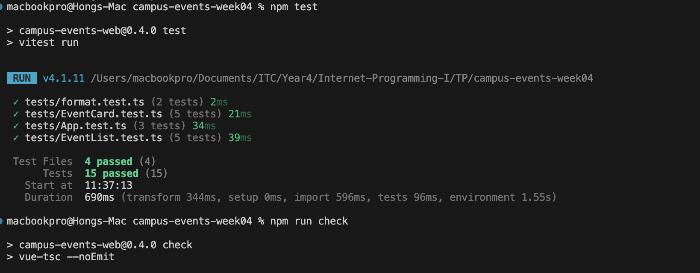

### 1. In EventList, what goes wrong if you use the array index as :key and the list gets filtered while a card has local state (for example an open details panel)?
> In EventList, if I use :key="index", the card only change by index not by id, so if I filtered Vue only swapped the new event data then it opens the wrong card since index only describe the position. With :key="e.id", Vue keep each card’s local state with its key, so the state follows the event whenever the event moves in list. 
### 2. Why is visible a computed and not a function called from the template? What is the difference when you type in the search box?
> ```Compute()``` vs ```Function```, Visible is a computed, so it's cached and only reruns when the data it read ```(search, category, events)``` changes. A function reruns on every re-render. When I type in the search box, search changes, so the computed filters once and the 3 places in the template share the result. A function would filter 3 times, and again on every other re-render
### 3. EventCard emits book instead of changing event.booked. Give two reasons.
> 1. Props are read-only: data flows down and events go up, and Vue warns if a child changes a prop
> 2. The parent owns the data and also decide what happen to the data, it's like a storage that checking and adding to the ```myBookings```.

### 4. You write const { booked } = reactive(event); booked++. The page does not change. Why?
> Destructuring reactive, ```booked``` is only copy the number into the plain local variable that is not linked to the reactive anymore. If there are anything change, Vue will not see it and with ```const``` Vue will throw an error. 
### 5. Where does myBookings live, and why not in EventCard or EventList?

> myBookings live in App. App needs the count for the header and update the events. There go both for the EventCard and EventList they are the components. EventCard is one card per event. Once it filtered, the filtered card will get destroy. EventList doesn’t render the header.

### Test and Check
   